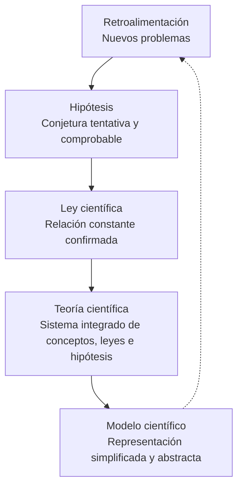

{d}

## Vías del conocimiento humano

- **Experiencia (sensación)**: conocimiento directo captado mediante los sentidos.
- **Intuición**: comprensión inmediata sin razonamiento deductivo explícito.
- **Razón**: operación lógica del intelecto que relaciona conceptos.
- **Autoridad y tradición**: aceptación de verdades por su origen institucional o acumulado.
- **Tradición científica**: convenciones, teorías previas y metodologías validadas comunitariamente.
- **Imaginación sociológica (C. Wright Mills)**: conectar experiencias individuales con procesos sociales e históricos globales. {a Apuntes de Universidad, sociedad y conocimientos · Unidad 3}

```asociar
titulo: Unir cada vía con su descripción
pares:
  - [Experiencia, Conocimiento directo captado por los sentidos]
  - [Intuición, Comprensión inmediata sin razonamiento explícito]
  - [Razón, Operación lógica que relaciona conceptos]
  - [Autoridad y tradición, Aceptación por origen institucional o acumulado]
  - [Tradición científica, Convenciones y metodologías validadas comunitariamente]
  - [Imaginación sociológica, Conectar lo individual con lo social e histórico (C. Wright Mills)]
o: d
```

## Operaciones lógicas e inferencia científica

- **Inducción**: de lo particular a lo general.
- **Deducción**: de lo general a lo particular.
- **Abducción**: de un hecho anómalo a la hipótesis más probable.
- **Análisis**: descomposición de un todo en sus partes.
- **Síntesis**: recomposición de las partes en un todo coherente.
- **Abstracción**: aislamiento de propiedades para construir conceptos genéricos.
- **Analogía**: semejanza entre fenómenos para transferir explicaciones.
- **Generalización**: extensión de una conclusión de una muestra a la población. {a Apuntes de Universidad, sociedad y conocimientos · Unidad 3}

```clasificar
titulo: ¿Qué operación lógica es?
categorias: [Inducción, Deducción, Abducción, Análisis, Síntesis, Abstracción, Analogía, Generalización]
items:
  - {x: "Observar 100 cuervos negros y concluir 'todos los cuervos son negros'", cat: 0, porque: "De casos particulares a una ley general."}
  - {x: "Partir de 'todos los humanos son mortales' y deducir 'Sócrates es mortal'", cat: 1, porque: "De premisa general a conclusión particular."}
  - {x: "Ver hierba mojada y conjeturar 'llovió anoche'", cat: 2, porque: "Hecho anómalo → hipótesis más probable."}
  - {x: "Descomponer una célula en orgánulos para estudiarlos", cat: 3, porque: "Rompe el todo en sus partes constitutivas."}
  - {x: "Integrar hallazgos de genética, ecología y evolución en una teoría", cat: 4, porque: "Recompone partes en un todo coherente."}
  - {x: "Aislar 'masa' y 'velocidad' para definir 'energía cinética'", cat: 5, porque: "Extrae propiedades genéricas de fenómenos concretos."}
  - {x: "Modelar el átomo como sistema solar (Bohr)", cat: 6, porque: "Usa semejanza con sistema conocido para explicar uno nuevo."}
  - {x: "De una encuesta a 1000 personas, inferir opinión de todo el país", cat: 7, porque: "Extiende conclusión de muestra a población."}
o: d
```

## Estructuras conceptuales de la ciencia

- **Problema de investigación**: interrogante o vacío de conocimiento.
- **Hipótesis**: afirmación conjetural tentativa que debe ponerse a prueba.
- **Ley científica**: proposición confirmada que describe relaciones constantes entre variables.
- **Teoría científica**: sistema integrado de conceptos, leyes e hipótesis.
- **Modelo científico**: representación simplificada y abstracta de un fenómeno. {a Apuntes de Universidad, sociedad y conocimientos · Unidad 3}

```explorable
titulo: De la hipótesis al modelo científico
variante: pasos
nodos:
  - {id: prob, titulo: Problema de investigación, resumen: Interrogante sobre la realidad., detalle: Pregunta clara y precisa que identifica un vacío de conocimiento.}
  - {id: hip, titulo: Hipótesis, resumen: Conjetura tentativa y comprobable., detalle: Respuesta provisional que debe someterse a prueba empírica.}
  - {id: ley, titulo: Ley científica, resumen: Relación constante confirmada., detalle: Describe regularidades empíricas universales entre variables.}
  - {id: teo, titulo: Teoría científica, resumen: Sistema integrado y coherente., detalle: Articula conceptos, leyes e hipótesis en marco explicativo.}
  - {id: mod, titulo: Modelo científico, resumen: Representación simplificada., detalle: Abstracción operativa para simular, predecir o intervenir.}
o: d
```

## Las tres funciones de la ciencia

Describir, explicar y predecir. {a Apuntes de Universidad, sociedad y conocimientos · Unidad 3}

- **Describir**: declarar cómo es y cómo se manifiesta un fenómeno.
- **Explicar**: responder por qué ocurre un hecho e identificar sus causas.
- **Predecir**: anticipar estados futuros a partir de leyes y modelos. {a Apuntes de Universidad, sociedad y conocimientos · Unidad 3}

```asociar
titulo: Unir cada función con su pregunta clave
pares:
  - [Describir, "¿Cómo es y cómo se manifiesta el fenómeno?"]
  - [Explicar, "¿Por qué ocurre? ¿Cuáles son sus causas?"]
  - [Predecir, "¿Qué sucederá bajo ciertas condiciones?"]
o: d
```

## Los 7 elementos del proyecto de investigación (Marradi et al., 2007)

1. Tema y fundamentación.
2. Antecedentes y marco teórico.
3. Objetivos (general y específicos).
4. Hipótesis.
5. Actividades y metodología.
6. Factibilidad y presupuesto.
7. Bibliografía. {a Apuntes de Universidad, sociedad y conocimientos · Unidad 3}

```caso
titulo: Diseñar un proyecto de investigación
escenario: Querés estudiar el impacto de la IA generativa en el aprendizaje universitario. Armás el proyecto.
pasos:
  - pregunta: ¿Por qué elemento empezás para delimitar el estudio?
    opciones:
      - {x: "Tema y fundamentación: definís el alcance y justificás su relevancia", ok: true, consecuencia: "Establece el qué y el por qué; guía todo el diseño posterior."}
      - {x: "Metodología: elegís las técnicas de recolección de datos", ok: false, consecuencia: "Sin tema delimitado, la metodología carece de dirección."}
      - {x: "Presupuesto: calculás los costos primero", ok: false, consecuencia: "El presupuesto depende de las actividades, no al revés."}
  - pregunta: ¿Qué rol cumple el marco teórico?
    opciones:
      - {x: "Ubica el problema en el estado del arte y define conceptos clave", ok: true, consecuencia: "Evita reinventar la rueda y da lenguaje común con la comunidad científica."}
      - {x: "Lista todos los libros leídos sin criterio", ok: false, consecuencia: "El marco teórico es selectivo y argumentado, no una bibliografía exhaustiva."}
o: d
```

:::sintesis
- Las vías del conocimiento incluyen experiencia, intuición, razón, autoridad y tradición científica.
- Inducción va de lo particular a lo general; deducción de lo general a lo particular; abducción conjetura la hipótesis más probable.
- Las estructuras conceptuales van del problema a la teoría y el modelo.
- Las funciones de la ciencia son describir, explicar y predecir. {a Apuntes de Universidad, sociedad y conocimientos · Unidad 3}
:::